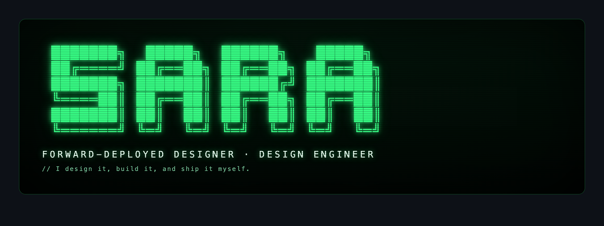

<p align="center">
  
</p>

## ▓▓▓ whoami

```text
$ whoami
sara khalil — forward-deployed designer & design engineer
based in dubai · senior manager, product design & cx @ landmark group

$ cat about.txt
# 9 years designing across fintech, retail, and SaaS.
# I don't hand off a file and walk away. I embed with the problem —
# close to the people who have it: stakeholders and real users.
# I bridge disciplines at the idea stage — design × engineering × product —
# then I design it, build it, and ship it myself.
```

## ▓▓▓ how I work

```text
   IDEA ──▶ DESIGN ──▶ BUILD ──▶ SHIP ──▶ MEASURE
    │                                          │
    └────────────  stakeholders + users  ──────┘
      // embedded the whole way — discovery, buy-in,
      // and the real environment, not a Figma wall.
```

## ▓▓▓ what that looks like

```text
▹ discovery with real users — not assumptions
▹ stakeholder buy-in earned with evidence — not opinions
▹ design systems & prototypes built to actually ship
▹ outcomes measured against a control — I keep the receipts
▹ AI woven through the whole workflow, from idea to build
```

## ▓▓▓ stack

**design**
&nbsp;


**build**
&nbsp;


**ai**
&nbsp;


## ▓▓▓ built with my agent team

```text
▹ RATCHET   "I built the whole thing."
▹ GUSTAVE   "The direction was mine."
▹ SIX       "I told her it wasn't good enough."
▹ ALOY      "I mapped every pattern first."
▹ HAZEL     "Every word, in her voice."
```

## ▓▓▓ stats

<p align="center">
  
  
</p>

## ▓▓▓ find me

[](https://www.linkedin.com/in/sara-eldebissy/)
[](https://x.com/SaraEldebissy)
[](https://www.figma.com/@saraeldebissy)

<sub>━━━  designed & vibe-coded by sara · forward-deployed  ━━━</sub>
