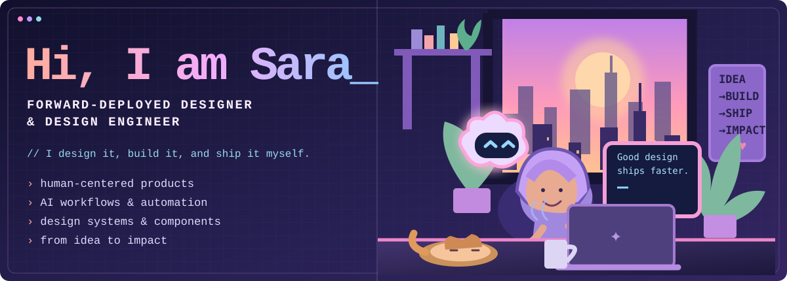

<p align="center">
  
</p>

<div align="center">

### Design × Research × Engineering × AI

**I design it, build it, and ship it myself.**

[Portfolio](https://sara-khalil.pages.dev/) · [LinkedIn](https://www.linkedin.com/in/sara-eldebissy/) · [Figma](https://www.figma.com/@saraeldebissy)

</div>

### ▸ `>_` whoami

```text
$ whoami
sara khalil — senior product designer & design engineer
dubai, uae · working where design, AI and real-world impact meet

$ cat about.txt
I design across e-commerce, fintech, and SaaS.
I don't hand off a file and walk away. I embed with the problem —
close to people, research, product and engineering.
I work from early discovery to the shipped experience.
```

### ▸ `>_` how I work

<p align="center">
  
</p>

### ▸ `>_` tools I've built

*Selected projects, experiments, and internal tools — some are prototypes and not publicly available.*

| Project | What it does | Explore |
| :--- | :--- | :--- |
| **Research Repo** | A searchable home for studies, insights and evidence. | Internal prototype |
| **NPS Insight Agent** | Groups comments into themes and issues; tracks trends week over week. | Internal prototype |
| **Bug Testing Platform** | Collects bugs, screenshots, and product feedback in one place. | In progress |
| **UX Research Skills** | Reusable Claude skills for responsible UX research. | [Repo ↗](https://github.com/saraeldebissy/ux-research-skills) |
| **Vibe Generator** | Experimental tool for generating and exploring ideas. | [Live ↗](https://vibe-generator-v2.vercel.app) · [Repo ↗](https://github.com/saraeldebissy/Vibe-generator-v2) |

<details>
<summary><b>＋ More things I've built</b></summary>

| Project | Explore |
| :--- | :--- |
| **Git Advisor** — Git copilot for designers | [Repo ↗](https://github.com/saraeldebissy/git-advisor) |
| **Mobbin MCP** — design inspiration via MCP | [Repo ↗](https://github.com/saraeldebissy/mobbin-mcp) |
| **Skill Atlas** — mapping product design capabilities | [Live ↗](https://skill-atlas-gray.vercel.app) · [Repo ↗](https://github.com/saraeldebissy/skill-atlas) |
| **Design Skills** — agentic design skills | [Repo ↗](https://github.com/saraeldebissy/design-skills) |
| **Build Bouncer** — challenge ideas before building | [Repo ↗](https://github.com/saraeldebissy/build-bouncer) |

</details>

### ▸ `>_` stack

**design**

    

**build**

     

**ai & automation**

     

### ▸ `>_` built with my agent team

```text
  RATCHET   "I built the whole thing."
  GUSTAVE   "The direction was mine."
  SIX       "I told her it wasn't good enough."
  ALOY      "I mapped every pattern first."
  HAZEL     "Every word, in her voice."
```

### ▸ `>_` stats

<p align="center">
  
  
</p>

<details>
<summary><b>＋ Contribution streak</b></summary>
<p align="center"></p>
</details>

<sub>Live statistics depend on external GitHub stats services and may not include private work.</sub>

### ▸ `>_` find me

[](https://www.linkedin.com/in/sara-eldebissy/)
[](https://x.com/SaraEldebissy)
[](https://www.figma.com/@saraeldebissy)
[](https://sara-khalil.pages.dev/)

<sub>━━━ building what's next, together · designed and built by Sara ━━━</sub>
