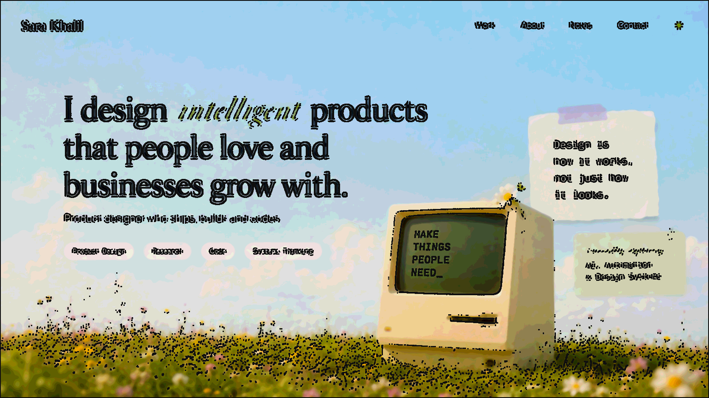

<p align="center">
  
</p>

## ▓▓▓ whoami

<p align="center">

```text
@@@@@@@@@@@@@@@@@@@@@@@@ @@@                       @@@@ @@@@@@@@@@@@@@@@@@@@@@@@
@@@@@@@@@@@@@@@@@@@@@@@@@                                  @@@@@@@@@@@@@@@@@@@@@
@@@@@@@@@@@@@@@@@@@@@@                                              @@@@@@@@@@@@
@@@@@@@@@@@@@@@   @                                                     @@@@@@@@
@@@@@@@@                                                                  @@@@@@
 @@@                             +-:.... ..-+                                   
                              =:. .=  @@@  -. :=                                
                            -....+#%#**##%@@@+..:=                              
                          =:....-=::.......:-+=::::                             
                         =.:::::-..      ...::----::                            
                         ::::::-::..  .  ...::-----:=                           
                        =:::----::..  .....:--===-==-                           
                        --------=+*++=::::=%@@##**=+=+                          
                        ------+*+**%%*=:.-*#%@@@%#*==+                          
                        -----=**@@@%#*+-.-**#%@%%*++++                          
                        -=---=+#%##*+=-=:.=====-:-=+++                          
                        -----+-:::::::--:.:-=-:::-=*                            
                        =-=--+=-:..:-====:-*#*+=-=+#                            
                         =-=-++=--:==-+*####*++***##                            
                         +=--+++==**==++++*##%@%*+**                            
                          +===+++=+*@%*=-:--=*@*==*                             
                           +==*+==--=**++==**#*+=+#                             
                          =-++=*+==---=++++++++++# =+                           
                          +-::=+ *+=------:----*%  =+                           
                           =-::-=* #*+=--:---=#@   =:-                          
                         +=+=-::--=+  %%###%%@@  +-::-                          
                        =::-===-:::-=+*  @@@@    -..-+                          
                       +:...:--=+=-::::-=+++++=-:.:=                            
              +==--::...--:...:::-+++=-::::::::--+   +-=                        
         +:..       . ...:--:.....::-=+             ===++                       
        :.  ...............::---:....:::--==+   ++==+  +::::-=+                 
      =:...  .................:--=---::::::--====+    -.........::=+            
     -:...........................:-=+++++        +=::.:............:=          
    -:.:..............................::------::::::::::............::-         
   -:.::..::.............. ..................:::::::::.............::::=        
  -::::..:::............. .............:::::::::::::..............:::::-+       
 =:::::..::...............................:::.:..................::::::-=       
=::::::.:-:..:.................................................:::--:::-+       
:::::::.:--::-::...........................................::.::::-=-::-++      
:::::-::.--.--::...........................................::::::--=-:::+       
:::::-:::==:==::...........................................:::::---=-:::+       
::::---::=+:++-:..........................................:::::--=-+-:::+       
```

</p>

```text
$ whoami
sara khalil — product designer, intelligent experiences
leading design for search & discovery @ landmark digital

$ cat philosophy.txt
# "technology should adapt to people,
#  not the other way around."
#
# that idea shapes how I think about products, systems,
# and the role of design in an increasingly intelligent world.

$ cat about.txt
# 9 years designing and shipping complex products across
# e-commerce, fintech, and SaaS — from early discovery and
# product strategy through systems, interaction design,
# prototyping, and execution.
#
# I craft products that do more than respond — using context,
# data, personalization, automation, and AI to help people
# make better decisions, with less effort, toward better
# outcomes.
```

## ▓▓▓ currently building

<p align="center">
  
</p>

```text
# the portfolio homepage — intelligent product design,
# shipped with code, not just mockups.
```

## ▓▓▓ how I work

```text
   IDEA ──▶ DESIGN ──▶ BUILD ──▶ SHIP ──▶ MEASURE
    │                                          │
    └────────────  stakeholders + users  ──────┘
      // embedded the whole way — discovery, buy-in,
      // and the real environment, not a Figma wall.
```

## ▓▓▓ what I bring

```text
▹ outcomes, not pixels — design tied to measurable results
▹ I build the things that build the thing — tools, workflows,
  systems, automations, prompts, frameworks
▹ I build what I design — ideas turned into working, shipped products
▹ I close the loop — ship, measure, learn, feed it back in
▹ range — zoom out to the product system, zoom into the interaction
```

## ▓▓▓ stack

**design**
&nbsp;


**build**
&nbsp;


**ai**
&nbsp;


## ▓▓▓ built with my agent team

```text
▹ RATCHET   "I built the whole thing."
▹ GUSTAVE   "The direction was mine."
▹ SIX       "I told her it wasn't good enough."
▹ ALOY      "I mapped every pattern first."
▹ HAZEL     "Every word, in her voice."
```

## ▓▓▓ stats

<p align="center">
  
  
</p>

## ▓▓▓ find me

```text
# open to meaningful conversations about design, AI, and the
# future of digital experiences. if you're exploring where
# products go next, I'd love to hear what you're working on.
# say hello.
```

[](https://www.linkedin.com/in/sara-eldebissy/)
[](https://x.com/SaraEldebissy)
[](https://www.figma.com/@saraeldebissy)

<sub>━━━  designed & vibe-coded by sara · intelligent experiences  ━━━</sub>
