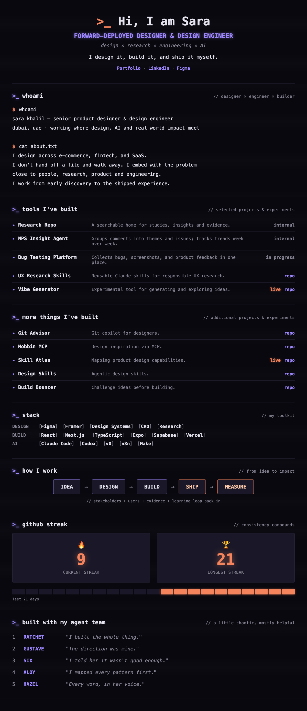
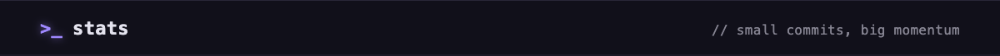
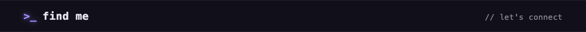
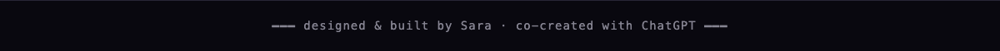

  

 

  
  

<b>＋ project links</b>

| Project | Explore |
| :--- | :--- |
| **UX Research Skills** | [Repo ↗](https://github.com/saraeldebissy/ux-research-skills) |
| **Vibe Generator** | [Live ↗](https://vibe-generator-v2.vercel.app) · [Repo ↗](https://github.com/saraeldebissy/Vibe-generator-v2) |
| **Git Advisor** — Git copilot for designers | [Repo ↗](https://github.com/saraeldebissy/git-advisor) |
| **Mobbin MCP** — design inspiration via MCP | [Repo ↗](https://github.com/saraeldebissy/mobbin-mcp) |
| **Skill Atlas** — mapping product design capabilities | [Live ↗](https://skill-atlas-gray.vercel.app) · [Repo ↗](https://github.com/saraeldebissy/skill-atlas) |
| **Design Skills** — agentic design skills | [Repo ↗](https://github.com/saraeldebissy/design-skills) |
| **Build Bouncer** — challenge ideas before building | [Repo ↗](https://github.com/saraeldebissy/build-bouncer) |

